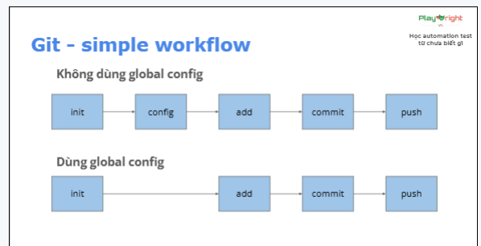

# GIT - DOCUMENT-2
## CONFIG CHO RIÊNG PROJECT HIỆN TẠI
- Config username (tên người dùng) cho riêng dự án hiện tại: git config user.name "Tên của bạn"
- Config email (địa chỉ email) cho riêng dự án hiện tại: git config user.email “<email của bạn>”
- Config branch default (nhánh mặc định): git config init.defaultBranch main

0. Đi vào trong 1 folder
- cd <tên folder>

1. Git status
- Kiểm tra trạng thái file
- file màu xanh: vùng staging
- file màu đỏ: vùng working

2. Git log
- Kiểm tra danh sách file đã đc commit
- Nếu gõ git log bị treo con trỏ --> bấm phím q

3. Git - commit convention (message khi commit)
- Cấu trúc: <type>: <short_description>. Trong đó:
• type: loại commit
		• chore: sửa nhỏ lẻ, chính tả, xóa file không dùng tới,...
		• feat: thêm tính năng mới, test case mới
		• fix: sửa lỗi 1 test trước đó
• short_description: mô tả ngắn gọn (50 kí tự), tiếng Anh hoặc tiếng Việt không dấu.
- Ví dụ:
• “chore: remove unused file”
• “feat: add code for exercises 2”
• “fix: fix automation for case 1”

4. Khi run file, nếu file nằm trong 1 folder --> lệnh: node 'tên folder'/'tên file' 

5. Phân biệt var và let
- var: cho phép khai báo lại. Ví dụ: var x = 1, sau đó tiếp tục khai báo var x = 2 ==> OK
- let: không cho phép khai báo lại. Ví dụ: let y = 1, sau đó tiếp tục khai báo let y = 2 ==> Lỗi y đã đc khai báo
- var có phạm vi global, còn let thì phạm vi theo block. Code nằm trong cặp ngoặc nhọn được gọi là “một block code”
- var (Function Scope): Không bị giới hạn bởi cặp ngoặc nhọn { } của if, for hay block thông thường. Biến ra khỏi dấu {} vẫn gọi được.
- let & const (Block Scope): Chỉ tồn tại bên trong cặp ngoặc nhọn { } nơi nó được khai báo. Ra khỏi dấu {} là không thể gọi tên biến được nữa

{
    var a = 10;
    let b = 11;
}
console.log(a); // In ra: 10
console.log(b); // Lỗi: ReferenceError: b is not defined

6. Biến và hằng
- Mặc định dùng Hằng: là giá trị không thay đổi được, dùng khai báo giá trị không có nhu cầu thay đổi hoặc chỉ dùng 1 lần. Lưu giá trị cố định, URL, selector/locator, hàm, object/array gốc --> khai báo hằng bằng const
+ Gán lại giá trị cho hằng sẽ báo lỗi TypeError: Assignment to constant 

- Chỉ dùng Biến khi: xác định chắc chắn gán lại giá trị. Lưu biến đếm, trạng thái, dữ liệu thay đổi theo thời gian --> khai báo biến bằng let, không dùng var

7. Kiểu dữ liệu
7.1 Number
- Tất cả các loại số đều dùng chung một kiểu duy nhất là Number, không tách riêng số nguyên (int) và số thực (float) 
- Bao gồm: Số nguyên (10, -5), số thập phân (19.99, 0.5), và các giá trị đặc biệt như Infinity (vô cực) hoặc NaN (Not a Number — xuất hiện khi phép tính toán học bị lỗi, ví dụ "abc" / 2).
7.2 String
- Dùng để lưu trữ dữ liệu dạng văn bản (tên người dùng, URL, thông báo lỗi, nội dung nút bấm...).
- 3 cách viết chuỗi trong JavaScript:
	1. Dấu nháy đơn: 'Hello Playwright'
	2. Dấu nháy kép: "E-commerce site"
	3. Dấu huyền (Backtick ` `): Cho phép nhúng trực tiếp biến vào bên trong chuỗi bằng cú pháp ${tên_biến} và viết xuống nhiều dòng.
• Thao tác thường gặp: Nối chuỗi (+ hoặc `${a} ${b}`), ví dụ: const message = `Xin chào ${username}, chào mừng đến với ${baseUrl}!`;
7.3 Boolean
- chỉ có duy nhất 2 giá trị: true (đúng) hoặc false (sai). Đây là nền tảng để điều khiển luồng chạy của chương trình (if / else) và kiểm tra kết quả (assert) trong automation test.
• Gán trực tiếp: const isVisible = true;
• Kết quả của phép so sánh: 10 > 5 (true), 'admin' === 'user' (false).
• Kết quả của toán tử logic: && (VÀ), || (HOẶC), ! (PHỦ ĐỊNH).

8. Kiểm tra biến là kiểu dữ liệu gì
- dùng hàm: typeof 'tên biến'

9. Toán tử so sánh
Toán tử so sánh dùng để so sánh 2 toán hạng. Ví dụ: a=5, b=10
Chia làm ba nhóm:
• So sánh bằng
	• == và ===
• So sánh không bằng
	• ! (Lưu ý bổ sung: trong JS dùng != và !==)
• So sánh lớn hơn, nhỏ hơn
	• >
	• <
	• <=
	• >=
- Phân biệt == và === 
+ ==: Chỉ so sánh giá trị. Nếu khác kiểu dữ liệu, JS tự động ép kiểu dữ liệu về giống nhau rồi mới so sánh.
+ ===: So sánh cả kiểu dữ liệu lẫn giá trị. Nếu khác kiểu dữ liệu thì trả về false ngay lập tức.	
	
+ ví dụ:  const num = 10;      // Kiểu Number
		  const str = "10";    // Kiểu String
		  ==> 10 == "10" --> true
		  ==> 10 === "10" -->false

10. Toán tử Logic 
- Toán tử logic dùng để kết hợp nhiều điều kiện và trả về boolean
• && (AND): trả về đúng nếu cả 2 vế của mệnh đề đúng
• || (OR): trả về đúng nếu một trong 2 vế của mệnh đề đúng

11. Toán tử 1 ngôi
- let a = 10; 
	b = ++a; // tăng a lên 1 rồi mới gán cho b ==> a = 11 (vì đã đc tăng lên 1) và b = 11)
	console.log(a,b);

- let c = 10; 
	d = c++; // gán c cho d rồi mới tăng c lên 1 ==> d = 10 và c = 11 vì sau khi gán xong thì c tăng lên 1)
	console.log(c,d);

12. Toán tử toán học 
- các phép toán cộng trừ nhân chia.. trong toán học: 
console.log(a+b); // cộng 2 số
console.log(a-b);//trừ 2 số
console.log(a*b);
console.log(a/b);
console.log(a%b);//lấy phần dư của phép chia a/b
console.log(a**b);// a^b

13. Câu điều kiện if
- Kiểm tra điều kiện đúng mới chạy
- Ví dụ:
let hour = 15;
if (hour > 6 && hour < 11 || hour === 11 ){
    console.log("Let's start day with a cup of matcha");
}

14. Vòng lặp for
- Lặp lại n lần 1 logic:
-Câu lệnh: 
for (<điều kiện khởi tạo>; <điều kiện lặp>; <cập_nhật>) {
    // code
}
Trong đó: 
• Điều kiện khởi tạo: chạy một lần duy nhất, khi vòng lặp bắt đầu.
• Điều kiện lặp: nếu đúng thì chạy tiếp, sai thì dừng.
• Cập nhật: chạy vào mỗi cuối vòng lặp, để thay đổi giá trị của biến đếm.

15. Format code
Phím: Alt + Shift + F
