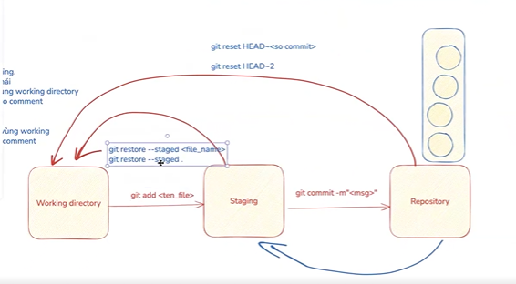
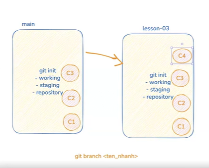

# GIT - DOCUMENT-3
### 1. Đưa 1 file từ staging về working --> chạy lệnh: git restore --staged 'file name'
- Tạo file1: file thuộc working directory, Git chưa quản lý thư mục này nên chúng chưa được theo dõi (Untracked)
- chạy lệnh git init -->  Git đã khởi tạo kho lưu trữ (.git). Git bắt đầu nhận diện thấy sự xuất hiện của file1 nhưng trạng thái của nó vẫn là Untracked vì chưa dùng lệnh add 
- chạy lệnh git add file1 --> add file 1 vào staging area
- **Muốn đưa file1 từ staging về working --> chạy lệnh: git restore --staged file1** --> file1 thuộc working directory (Untracked)

#### Đưa toàn bộ các file ở staging về working --> chạy lệnh: git restore --staged .

### 2. Đưa 1 file (file được commit gần nhẩt) từ repository về working (un-commit) --> chạy lệnh: git reset HEAD ~1
- Tạo file2: file thuộc working directory, Git chưa quản lý thư mục này nên chúng chưa được theo dõi (Untracked)
- chạy lệnh git init -->  Git đã khởi tạo kho lưu trữ (.git). Git bắt đầu nhận diện thấy sự xuất hiện của file2 nhưng trạng thái của nó vẫn là Untracked vì chưa dùng lệnh add 
- chạy lệnh git add file1 --> add file2 vào staging area
- chạy lệnh git commit -m"message" file2 được lưu chính thức vào Local Repository
- **Muốn đưa file2 từ từ repository về working (un-commit) --> chạy lệnh: git reset HEAD ~1** --> file2 thuộc working directory (Untracked)  
### 3. Commit đầu tiên không thể reset. Nếu muốn reset --> phải xóa thư mục .git đi rồi init lại

__3 VÙNG CỦA GIT__

### 4. Git: branch
- Git sử dụng nhánh (branch) để tạo ra các “phiên bản” riêng của code, tránh ảnh hưởng tới “bản gốc”
- Khi khởi tạo repo (git init), branch mặc định (main) sẽ được tạo ra.
- Ở bài 1, chạy lệnh: git config --global init.defaultBranch main -> cấu hình: khi khởi tạo, đặt branch mặc định là nhánh main
4.1 Xem list branch: git branch (phải có ít nhất 1 commit mới hiển thị list)
4.2 Tạo branch mới: git branch <tên_branch> (branch mới sinh ra sẽ giống y hệt branch cũ, ví dụ branch main đang có 3 commit của file1,2,3 --> khi tạo branch mới cũng sẽ có 3 commit của file1,2,3. Nhưng về sau khi đứng ở branch mới tạo file4, git add file4, git commit file4 thì sẽ chỉ hiện ở branch mới chứ không hiện ở branch main)
**LUÔN PULL CODE TRƯỚC KHI TẠO BRANCH MỚI**

4.3 Chuyển sang branch khác: git checkout <tên_branch>
4.4 Tạo branch mới đồng thời chuyển sang branch mới: git checkout -b <tên_branch>
4.5 Xóa branch: git branch -D <tên_branch>
	• Lưu ý: đứng ở branch khác trước khi xoá.

### 5. Git ignore
- File .gitignore là một tệp văn bản thuần đặt ở thư mục gốc của dự án, dùng để khai báo danh sách các file và thư mục mà Git sẽ chủ động bỏ qua, không theo dõi trạng thái (untracked) và không đưa vào commit.
- Vào trong file .gitignore và gõ tên file muốn bỏ qua:
+ ten-file.txt: Bỏ qua tất cả file có tên 'ten-file.txt' ở mọi thư mục.
+ tên-thư-mục/ten-file.txt: Chỉ bỏ qua file 'ten-file.txt' nằm ngay tại thư mục 'tên-thư-mục'.
+ ten-thu-muc/: Bỏ qua toàn bộ thư mục 'ten-thu-muc' cùng mọi file bên trong (luôn thêm dấu / ở cuối).
+ *.log: Dùng ký tự đại diện * để bỏ qua mọi file có đuôi .log.
+ !important.log: Dấu ! ở đầu dùng để ngoại lệ (theo dõi lại file này dù trước đó đã dùng *.log để chặn).

### 6. Convention
6.1 snake_case: ví dụ: nguyen_thanh_binh
6.2 kebab-case: nguyen-thanh-binh
6.3 camelCase: nguyenThanhBinh
6.4 PascalCase: NguyenThanhBinh

- Sử dụng convention trong lớp học:
+ snake_case: tạm thời không dùng
+ kebab-case: đặt tên file và folder
+ camelCase: đặt tên biến, hàm
+ PascalCase: đặt tên class

### 7. OBJECT
- là một trong những kiểu dữ liệu quan trọng nhất trong JavaScript, dùng để lưu trữ dữ liệu dạng key-value.
- Cấu trúc: 
const/let <variable_name> = {
    key1: value1,
    key2: value2,
    ...
}
Trong đó:
• key: giống quy tắc đặt tên biến, luôn là kiểu string nhưng không cần đặt trong dấu nháy '', "", chỉ cần đặt trong dấu nháy khi tên key có khoảng cách hoặc kí tự đặc biệt.
• value: có kiểu giống biến, hoặc là 1 object khác. Chỉ đặt trong dấu nháy khi giá trị đó mang kiểu dữ liệu chuỗi

- Truy xuất giá trị của object: Sử dụng dấu chấm or dấu ngoặc vuông
• Dùng dấu chấm: nếu key không chứa dấu cách, kí tự đặc biệt
• Dùng dấu ngoặc vuông: nếu key chứa dấu cách hoặc kí tự đặc biệt

### 8. Array
### 9. Function

### 10. Git amend: lệnh cho phép sửa đổi commit gần nhất — thay đổi message, thêm/bớt file, hoặc cả hai. Thay vì tạo commit mới, nó sửa lại commit cuối cùng.
10.1 Sửa commit message
- Lệnh: git commit --amend -m "Message mới chính xác hơn"
- Hoặc git commit --amend --> enter --> mở ra màn editor và sửa message trực tiếp trên màn editor này. 
+ Bấm phím I để open mode edit (cuối màn hình hiển thị chữ INSERT) và sử dụng phím mũi tên để di chuyển rồi sửa đổi.
+ Sửa xong, bấm phím Esc để thoát mode edit (chữ INSERT cuối màn hình biến mất). Ở dòng cuối màn hình gõ ':wq' --> enter
--> update thành công msg

10.2 Thêm file vào commit cuối cùng và không thay đổi msg của commit
- Add file: git add file3
- Sau đó dùng lệnh: git commit --amend --no-edit ==> file3 đc thêm vào commit cuối cùng và k làm thay đổi msg của commit cuối cùng

10.3 Thêm file vào commit cuối cùng và có thay đổi msg của commit
- Add file: git add file4
- Sau đó dùng lệnh: git commit --amend --m"msg muốn thay đổi" ==> file4 đc thêm vào commit cuối cùng và update lại msg của commit cuối cùng